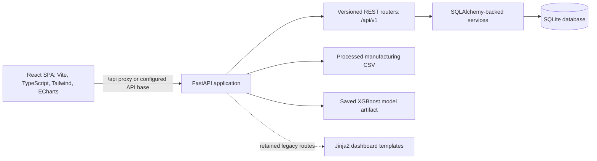

# EcoTwin Technical Documentation

This guide describes the current repository implementation. It distinguishes the active React/API path from retained legacy modules and records limitations that affect interpretation. It is not a claim of production deployment or verified site performance.

## 1. System architecture



### Frontend

`frontend/src/main.tsx` boots the React application. `frontend/src/App.tsx` supplies the theme provider, router, query client, shared shell, and lazy-loaded routes: overview, machine fleet/detail, energy intelligence, anomaly center, recommendations, What-If, impact, data management, reports, and settings. Feature-specific API calls live in `frontend/src/lib/api.ts`; shared contracts live in `frontend/src/types/api.ts`. ECharts are wrapped in chart components under `frontend/src/components/charts/`. Theme choice is browser-local and separate from persisted energy configuration.

### Backend

`dashboard/app.py` creates the FastAPI app, initializes the database during lifespan startup, and mounts the versioned API router from `src/api/v1/__init__.py` at `/api`. The version router adds `/v1`, resulting in public paths such as `/api/v1/overview`. An empty database's initial seed reads the processed CSV; the saved model and legacy analytics dataframe are loaded on demand only for retained model-backed routes. The active React REST routes use SQLAlchemy-backed services. The application also retains legacy server-rendered dashboard routes and templates; these are not the React SPA routes.

Business logic is mostly in `src/services/`, ORM entities/session setup are in `src/db/`, request/response schemas are in `src/schemas/`, physical assumptions and provenance labels are in `src/utils/constants.py`, and data loading/processing is in `src/data/`.

The older standalone modules `src/optimization/simulator.py` and `src/optimization/recommender.py` contain a hard-coded Windows workspace path inserted into `sys.path`. They are not the implementation used by the active What-If REST route. They may need path cleanup before being invoked from another checkout or operating system.

### Startup and configuration

- `DATABASE_URL` is read by `src/db/database.py` when the Python process imports the database module. The default is a relative SQLite URL (`sqlite:///./ecotwin.db`), so the effective path depends on the process working directory.
- The FastAPI lifespan calls `src/db/bootstrap.py`: missing tables are created, and `src/db/seed.py` is invoked only if every application data table is empty. Existing rows prevent automatic demo seeding; partial or existing databases are preserved rather than supplemented.
- The legacy model/data loader is lazy and thread-guarded. First-time empty-database seeding separately reads the CSV but does not load the predictor artifact. If a legacy model-backed route cannot load its dataset/model, that route returns HTTP 503; database-backed `/api/v1` endpoints remain available. The app does not retrain the model.
- Vite is configured for port 5173 and proxies `/api` to `http://localhost:8000`. The frontend's optional `VITE_API_BASE_URL` overrides its request prefix; it does not, by itself, reconfigure Vite's proxy target.
- CORS reads comma-separated exact origins from `FRONTEND_ORIGINS`; paths and wildcard origins are rejected. Local Vite origins are the fallback only when that variable is unset; an explicit production list replaces them.

## 2. Main API surface

FastAPI exposes `/openapi.json` and `/docs`. API routers currently registered under `/api/v1` include:

| Method | Path | Implementation and notes |
| --- | --- | --- |
| `GET` | `/api/v1/health` | Health/status route. |
| `GET` | `/api/v1/overview` | Aggregated overview and fleet summary via `OverviewService`. Some scores are heuristic indicators. |
| `GET` | `/api/v1/machines` | Configured machines and latest readings. |
| `GET` | `/api/v1/machines/{machine_id}` | Machine metadata, operating stats, recent readings, related anomaly records. |
| `GET` | `/api/v1/telemetry` | Filterable, paginated stored telemetry. |
| `GET` | `/api/v1/anomalies` | Filterable, paginated persisted anomaly events. Listing does not establish a physical fault. |
| `POST` | `/api/v1/anomalies/{anomaly_id}/resolve` | Stores an operator resolution note/status. |
| `GET` | `/api/v1/energy/overview` | Energy/cost/emissions summary. |
| `GET` | `/api/v1/energy/machine-comparison` | Per-machine SEC, energy, cost, and CO₂-tonne values. |
| `GET`, `PUT` | `/api/v1/config` | Read and persist system-setting values. Numeric settings have finite/range validation. |
| `GET` | `/api/v1/recommendations` | Rule/evidence-oriented recommendations; inspect response `evidence_source`, `evidence_summary`, `provenance`, and optional `assumptions`. |
| `POST` | `/api/v1/whatif/simulate` | Runs the database-backed `SimulationService`; does not save a scenario. |
| `POST` | `/api/v1/whatif/save` | Saves caller-supplied scenario parameters/results. |
| `GET` | `/api/v1/whatif/scenarios` | Lists persisted scenarios, optionally filtered by machine. |
| `POST` | `/api/v1/demo-data/reset` | Requires explicit `confirm: true`; fail-closed reset of whitelisted demo anomaly status flags only. |

The React app uses these routes through `frontend/src/lib/api.ts`. The exact request/response schema is in OpenAPI and `src/schemas/__init__.py`; use those as the contract source of truth.

## 3. Database structure

SQLAlchemy models are defined in `src/db/models.py`. The current schema contains:

- **`machines` (`Machine`)** — machine identifier, display name, machine/model type, rated power, status, and timestamps.
- **`production_batches` (`ProductionBatch`)** — batch identifier, product type, target quantity, and creation metadata.
- **`telemetry_readings` (`TelemetryReading`)** — timestamp, machine/batch links, product/shift context, rotational speed, torque, tool wear, air/process temperature, temperature difference, machine-failure flag, mechanical/electrical power, cycle time, energy, SEC, idle time, ambient context, maintenance context, electricity tariff, and provenance tier.
- **`anomaly_events` (`AnomalyEvent`)** — telemetry/machine links, timestamp, actual/predicted kWh, residual, z-score, severity, reason code, contributors, potential-saving estimate, resolved flag, notes, and resolution timestamp.
- **`system_settings` (`SystemSetting`)** — key/value/description and update metadata, including configured grid factor and base tariff.
- **`simulation_scenarios` (`SimulationScenario`)** — scenario name, machine, JSON parameters/results, and creation timestamp.

The repository's root `ecotwin.db` is local user data; it is excluded from the portable source ZIP. The source seeder does not drop or clear tables.

## 4. Data sources and provenance

### Benchmark inputs and derivations

`src/data/loader.py` validates the AI4I 2020 predictive-maintenance columns. The benchmark includes sensor-like fields such as torque, rotational speed, temperatures, tool wear, and benchmark failure labels; it does **not** contain an electrical kWh meter reading. `src/data/processor.py` derives mechanical power, electrical power, energy, and SEC. Its documented base derivation is:

1. `ω_rad_s = rotational_speed_rpm × 2π / 60`
2. `P_mechanical_W = torque_Nm × ω_rad_s`
3. `P_electrical_W = P_mechanical_W / η`, where the processing default `η` is 0.85.
4. Product-type cycle time: L = 1.5 minutes, M = 3.0 minutes, H = 5.0 minutes; unknown types default to 3.0 minutes.
5. `E_kWh = P_electrical_W × (cycle_time_minutes / 60) / 1000`.
6. `SEC_kWh_per_part` equals the derived per-part energy for one record/part.

These are deterministic physics-based estimates conditioned on benchmark input values and assumptions—not electricity-meter measurements. The saved telemetry stores `provenance_tier`; the source seed currently assigns the physically-derived tier to inserted records.

### Demonstration context

`src/data/synthetic.py` uses a fixed seed to attach synthetic machine IDs, energy penalties/drift, shifts, tariff assignments, idle durations, maintenance values, ambient context, and batch IDs. These enriched columns are useful for exercising the UI and services but are not observations from a real factory. The processed CSV and seeded SQLite rows should be labeled as demonstration/derived data in any presentation.

The code defines five tiers in `src/utils/constants.py`: direct/benchmark input, physically derived, calibrated/synthetic context, model output, and simulation result. A tier label records the code's declared provenance category; it is not external verification.

## 5. Energy, SEC, cost, and emissions

### Recorded-energy aggregates

`EnergyService`/`OverviewService` aggregate stored `energy_kwh`. Machine average SEC is the machine's total stored energy divided by its recorded part/reading count; facility average SEC is the corresponding aggregate ratio. The fleet page's per-machine SEC is not a fleet-wide scalar. Displayed units are `kWh/part`.

### Energy comparison cost and CO₂

The energy comparison API uses the configured `base_tariff_inr` and `grid_emission_factor` assumptions. The principal calculations are:

- `cost_inr = total_energy_kwh × base_tariff_inr` (API rounding follows the endpoint implementation).
- `co2_kg = total_energy_kwh × grid_emission_factor_kg_per_kwh`.
- `co2_tonnes = co2_kg / 1000`.

A displayed CO₂ tonne quantity is an estimate from energy and a configured factor. The configured defaults in `src/utils/constants.py` are 8.50 INR/kWh and 0.716 kg CO₂/kWh; system settings can override the values used by relevant services. Their jurisdiction/date relevance must be checked before external use. Stored row-level tariffs and TOU assumptions are not used uniformly across every aggregate.

### Derived indicators

Fleet efficiency scores, facility health scores, anomaly severity, and savings-opportunity fields are algorithmic/heuristic indicators—not calibrated physical machine efficiency or verified financial benefit. An anomaly is a statistical/rule flag, not proof of a mechanical fault. Residual energy is not automatically recoverable energy.

## 6. Saved predictive model

`models/best_energy_model.joblib` loads as an `EnergyPredictor` with model type XGBoost. The saved artifact declares this feature order:

- `power_watts`, `rotational_speed_rpm`, `torque_nm`, `tool_wear_min`, `air_temp_k`, `process_temp_k`, `cycle_time_minutes`, `idle_time_seconds`, `product_type_encoded`, `shift_encoded`, `maintenance_days_since`, `ambient_temperature`.

The target is energy prediction (`predicted_kwh`) as consumed by the dashboard/model path. The artifact has stored training metadata; those training statistics are **not** independent holdout validation and are not reported here as demonstrated performance. Important limitation: the feature list includes `power_watts` and `cycle_time_minutes`, which are components/inputs of the deterministic energy derivation. Consequently, the model's outputs should not be represented as an independent validation of the physical calculation or as evidence of generalization. `EnergyPredictor.NON_LEAKY_FEATURES` exists and is covered by a test, but the existing serialized artifact's feature list is the legacy list above. This documentation records the artifact as-is; it does not retrain or alter it.

`docs/experiment_log.csv` preserves historical reported comparisons, including an explicitly flagged legacy/leaky XGBoost row. The file does not by itself reproduce the data split, artifact-to-row mapping, or evaluation procedure; those claims have not been independently verified in this packaging pass. Treat the CSV as historical project notes, not as validated performance evidence.

Model predictions, residuals, z-scores, and any optional SHAP values are model/statistical outputs. They depend on training data, schema, feature encoders, and operating-range assumptions. Missing dependencies or incompatibilities may make explainability unavailable. Check `EnergyPredictor.check_extrapolation`/simulation warnings before interpreting out-of-range predictions; warnings are not physical safety certification.

## 7. Anomaly handling

The active REST APIs serve persisted `AnomalyEvent` records and allow filtering/resolution. The seed utility creates demonstration events by comparing stored energy to a nominal physics calculation and applying a residual threshold; its contributor/reason fields are seeded context. The legacy dashboard's model-based residual path is separate from the database-backed event list. `src/models/anomaly.py` and explainability modules provide additional analytics components, but the existence of a class/module does not mean every active API request runs it.

An anomaly indicates deviation from a chosen baseline/model. It does not identify root cause, diagnose failure, or prove recoverable energy. Investigate against machine logs, manufacturer limits, maintenance evidence, and appropriate instrumentation before acting.

## 8. What-If simulation assumptions

The React REST route delegates to `src/services/simulation_service.py` (`SimulationService`), which is distinct from the older `src/optimization/simulator.py` module. The active service:

1. Uses average machine telemetry as the baseline and errors if the machine has no readings.
2. Changes speed/torque and inversely adjusts cycle time for speed changes.
3. Calculates mechanical/electrical cutting energy with a hard-coded motor efficiency of 0.85.
4. Applies a heuristic tool-replacement friction reduction (5% or 10% depending on baseline wear) and an auxiliary idle-load assumption of 1.2 kW.
5. Applies a minimum simulated energy floor of 0.05 kWh per part.
6. Estimates tariff impact from a selected shift tier (normal, peak, off-peak); annualization assumes 800 parts/day by default and 300 operating days.
7. Uses configured base tariff and grid-emissions factor where available; returns an OOD distance, reliability label, warnings, and `SIMULATION — Physics & Empirical Estimate` provenance label.

These are assumptions and projections, not meter-verified savings. Some inputs are not strictly coupled to measured machine constraints, the friction percentages/auxiliary load/production/day count are heuristic defaults, and OOD labels are not safety approvals. The Settings schema stores a `motor_efficiency` value, but the active simulation code uses the fixed 0.85 constant rather than reading that setting; do not assume editing that setting changes the active simulation formula without an implementation change and test.

Saved scenarios persist the supplied inputs and outputs. Their presence does not mean the scenario was executed on equipment or that the result occurred.

## 9. Impact verification and measurement requirements

The Impact view/calculation code can compare before/after values and annualize estimates, but the current repository does not implement a complete independent measurement-and-verification protocol. A displayed projection or calculated difference is not a verified saving.

Before reporting realized energy/cost/emissions impact, an operator would need at minimum: a documented baseline period; calibrated, time-aligned meters and production/output normalization; comparable operating conditions; a defined adjustment method for product mix, weather, shifts, downtime and production changes; tariff invoices and current emissions-factor source/vintage; uncertainty bounds; persistence/quality checks; and independent review/approval. Define boundaries and avoid double-counting. Use measured energy for realized energy savings; apply approved tariff/emissions assumptions separately and report those as derived conversions.

## 10. Demo reset safety contract

`POST /api/v1/demo-data/reset` requires `{"confirm": true}`. The service validates the fingerprint of the original whitelisted demo anomalies and associated telemetry before changing anything. It updates only their resolution status/note fields; it does not delete/recreate anomaly or telemetry rows, alter measurements, modify machines/settings/scenarios, or touch the model artifact. If a changed reset is needed, it creates and integrity-checks a SQLite backup first; if the fingerprint does not match, it fails closed. An already-reset request is idempotent and does not create another backup. Tests use isolated temporary SQLite files. Never test this operation against a live database.

## 11. Verification commands

Backend tests (from repository root):

```powershell
.\.venv\Scripts\python.exe -m pytest -q
```

Frontend:

```powershell
Set-Location frontend
npx tsc --noEmit --project tsconfig.app.json
npm run lint
npm run build
```

For any suite that may write through the app-level SQLAlchemy engine, set `DATABASE_URL` to a fresh test database and seed that database before running API tests. Preserve the original working `ecotwin.db`; do not use it for reset or mutation testing.


## 12. Render Free deployment configuration

The root `render.yaml` describes two services: a Python 3.12.9 FastAPI web service (`uvicorn dashboard.app:app --host 0.0.0.0 --port $PORT`) and a static Vite frontend built from `frontend/`. The frontend build receives `VITE_API_BASE_URL=https://ecotwin-api.onrender.com/api`; the API allows `https://ecotwin-frontend.onrender.com` through `FRONTEND_ORIGINS`. If Render assigns different service hostnames or a custom domain is used, update both values to the exact API prefix and browser origin. The API health check is `/api/v1/health`.

The Blueprint sets `DATABASE_URL=sqlite:////tmp/ecotwin.db`. Render Free's filesystem is ephemeral, not durable storage: data can disappear on restart, redeploy, or instance replacement. An empty database is initialized and seeded on startup; a persistent production database and backup/restore plan are required for durable user data. No Render deployment has been performed or externally verified.

The predictor and processed CSV are not loaded for the active database-backed API at startup; this avoids importing the saved model's scikit-learn/XGBoost stack on the normal path. A fresh empty database still invokes CSV seeding, which uses pandas and NumPy. The configured 512 MB instance limit has not been measured under a live Render workload, so memory sufficiency is not empirically verified. Keep legacy dashboard routes off the critical startup path and monitor memory during any deployment trial. This prototype configuration does not provide authentication or a production multi-user security boundary.
